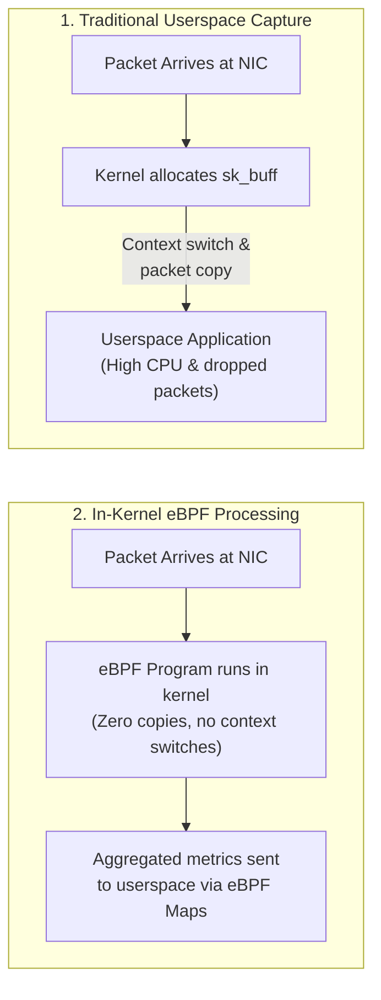
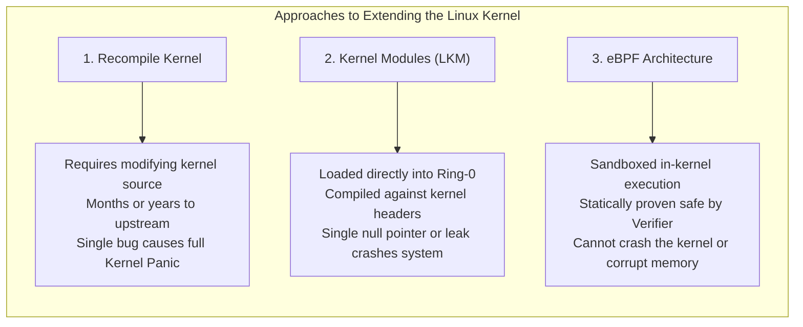
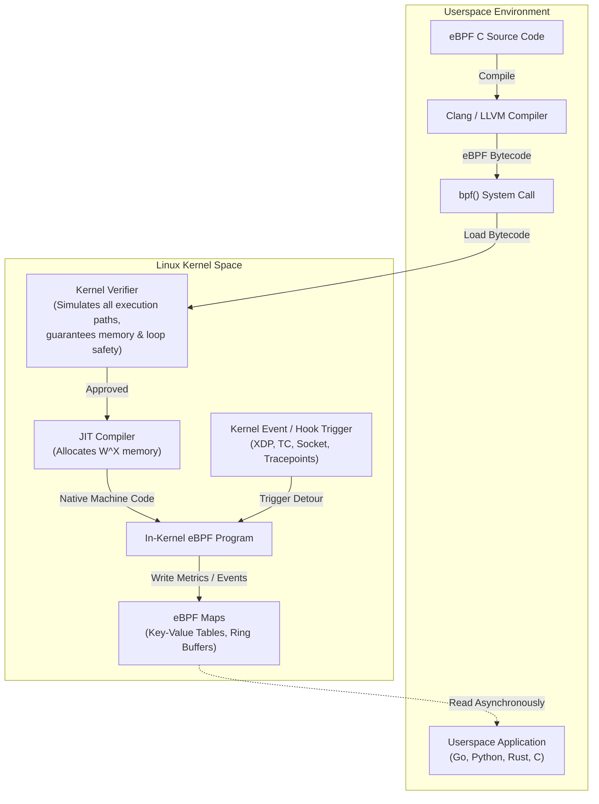
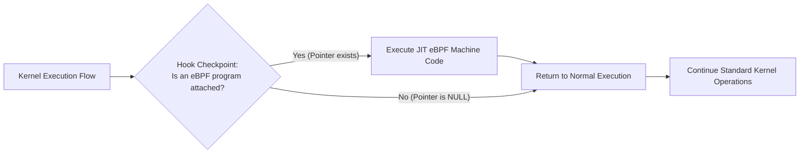
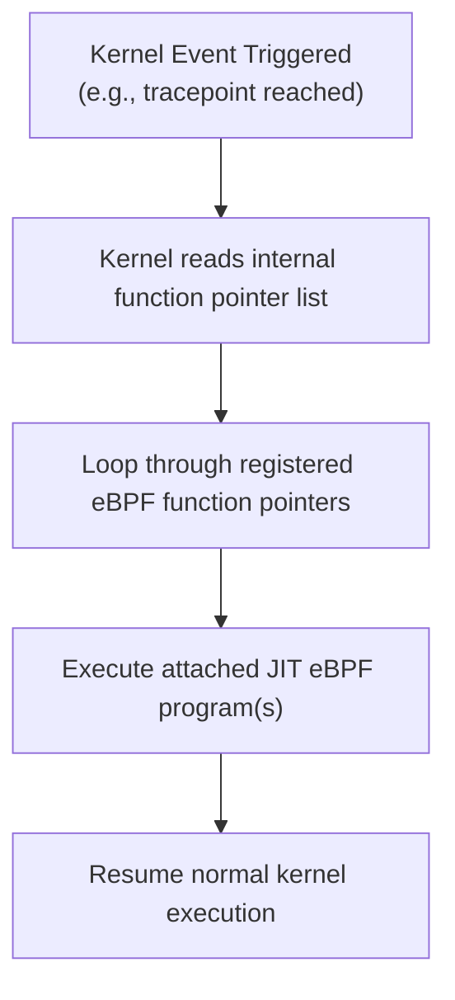
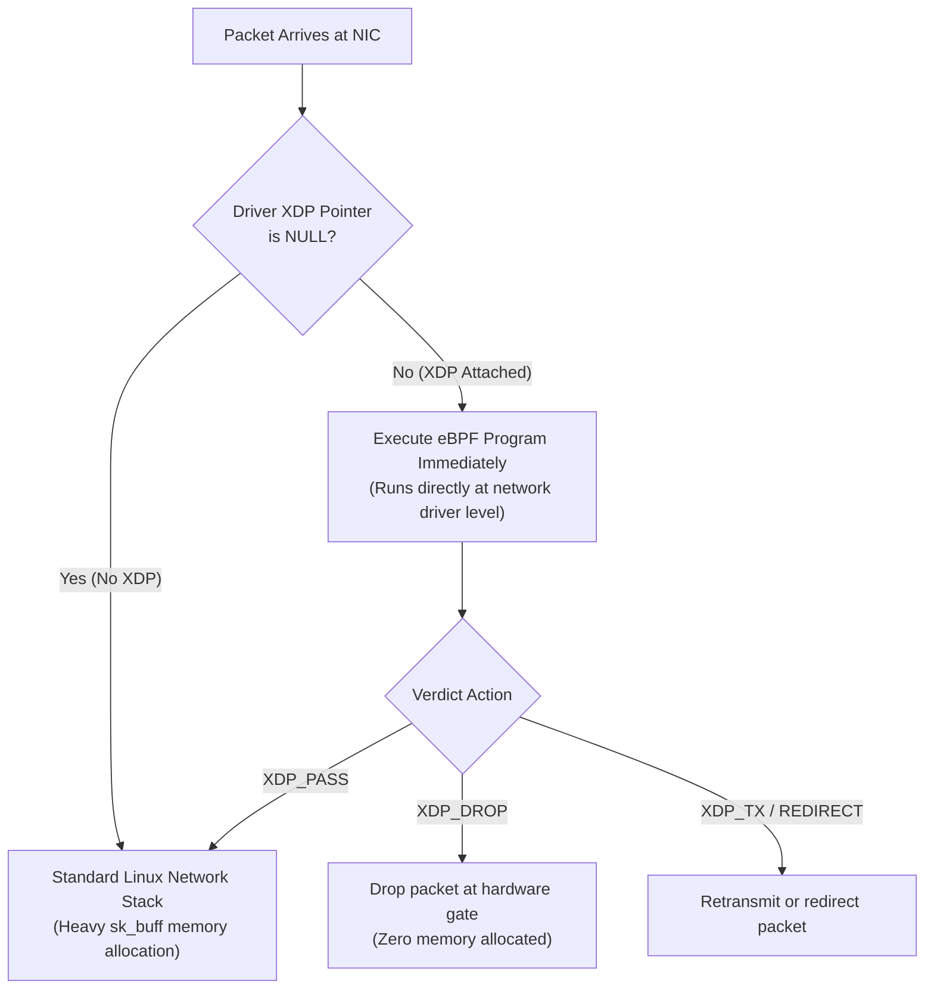
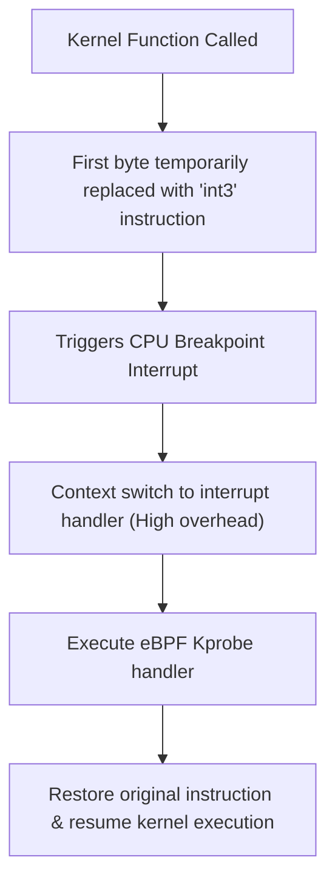
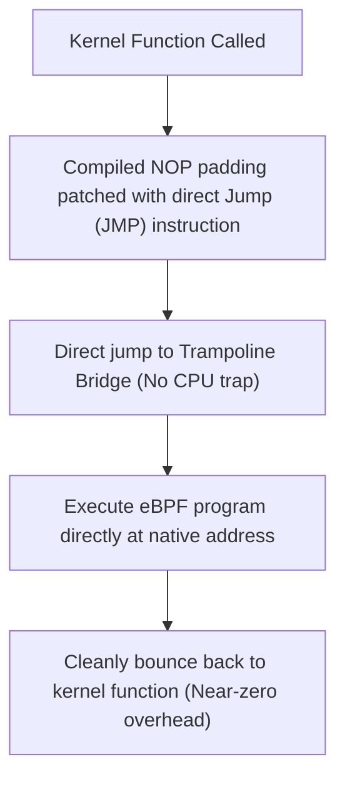
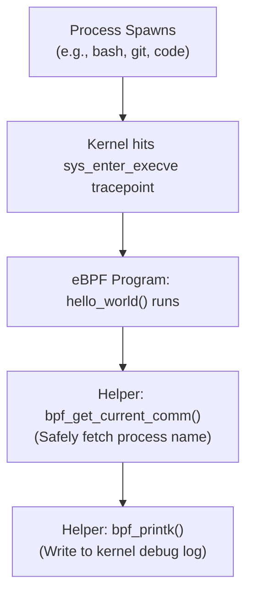

**eBPF** stands for *Extended Berkeley Packet Filter*.

Imagine one day you're sitting in front of your computer and all of a sudden you wonder how a network monitor or similar application works when clearly it isn't part of the kernel.

This was the exact situation I was faced with.

So I went digging...

---

## Why Not Just Capture in Userspace?

The obvious question that comes up is: *"Why touch the kernel at all? Why can't a normal userspace application just capture and inspect packets like `tcpdump`?"*

Technically, it can. Tools like `tcpdump` traditionally use packet sockets (`AF_PACKET`) to tap into network traffic. However, this approach hits a massive performance bottleneck at scale due to two key costs:

1. **Context Switches:** Every time packets arrive, the CPU must repeatedly switch execution contexts between kernel space and user space to wake up the monitoring application.
2. **Memory Copies:** The kernel has to allocate a full socket buffer (`sk_buff`) and physically copy the packet payload across the kernel-to-userspace memory boundary.

At modern line rates (10 Gbps, 40 Gbps, or higher—translating to millions of packets per second), the CPU spends nearly all its cycles copying packet memory and context switching rather than doing real work. The application quickly gets saturated, resulting in high latency and dropped packets.



To achieve true line-rate performance and low-overhead observability, the filtering logic **must run inside the kernel**, directly where the network events occur.

---

## Extending the Linux Kernel: The Three Approaches

There are a few ways where we can essentially extend the functionality of the kernel:

1. **Editing the Kernel and Recompiling**
   Very complex task. Beyond taking months or years to get changes upstreamed, making a single bug in your code means that even if it compiles, the kernel can panic and crash the entire system.

2. **Kernel Modules (LKM)**
   Arguably the most popular historical approach. Kernel modules are compiled against kernel headers, essentially becoming an extension of the kernel itself. However, they face the problem where they run with full Ring-0 privilege—if you make a single error (like a null pointer or memory leak), your entire kernel will crash.

3. **eBPF**
   eBPF is arguably the best approach. It allows executing sandboxed programs inside the operating system kernel without changing kernel source code or loading crash-prone kernel modules.



---

## The eBPF Architecture and Lifecycle

Here is how an eBPF program goes from user code to safe kernel execution:

* **You write the logic in C:**
  You write a small function describing what you want to do (e.g., "every time a packet arrives, read its destination port, and increment a counter in a table").

* **The kernel safety check (Verifier):**
  You compile that code into eBPF bytecode in userspace (using Clang/LLVM) and hand it to the Linux kernel via the `bpf()` system call. The kernel's verifier statically simulates every instruction to prove that your code will never crash the system, read out-of-bounds memory, or get stuck in an infinite loop.

* **Hooking into the pipeline:**
  Once approved, the kernel turns that bytecode into native CPU instructions (via a JIT compiler) and attaches it to an event hook. In your packet example, it could attach to:
  * **XDP (eXpress Data Path):** Right at the network driver level for ultra-fast processing before the kernel even allocates memory for the packet.
  * **TC (Traffic Control):** A bit further up the Linux networking stack.
  * **Socket Filter:** Right as packets reach a socket (like `tcpdump`).

* **Storing and sharing the data (Maps):**
  Because eBPF programs run and exit quickly every time an event happens, your program can't store data in normal local variables. Instead, it writes into an in-kernel data structure called an eBPF Map (a key-value table or ring buffer).

* **Userspace reads the result:**
  Your userspace app (written in Go, Python, C, or Rust) simply reads from that same Map to show you real-time packet statistics—without ever slowing down or modifying the core Linux kernel files.



---

## Memory Management and the W^X Model

So eBPF definitely sounds great, but what in the world are hooks and how are eBPF programs attached to them?

Well, let's start off by going deeper into how eBPF programs are handled with respect to memory.

As we've seen earlier, the eBPF code is first compiled in userspace to bytecode and loaded into kernel heap memory via the `bpf()` syscall. After being statically verified, the JIT compiler allocates executable memory pages with **W^X (Write XOR Execute)** permissions and compiles the bytecode into native machine code. Once this is done, the machine code sits safely in kernel memory until a hook triggers it.

---

## Understanding Kernel Hooks

Great, but now what are hooks?

Well, in very simple terms, **hooks are checkpoints in a kernel execution path where the CPU checks for the existence of an eBPF program.** If one exists, the CPU detours and runs the eBPF program before continuing; if it doesn't, the CPU just moves on to the next step in the process.



---

## How eBPF Programs Attach to Hooks

Nice, but how are eBPF programs inserted/attached to these hooks?

Well, there are a few primary ways:

### 1. Pointer Lookups (Static Checkpoints / Tracepoints)

This is a method where the kernel maintains an internal array or linked list of function pointers associated with a specific event. When we attach our program via `bpf()`, the address of the JIT-compiled eBPF code is registered into that list. When the kernel reaches this specific hook, it loops through the pointers and executes the attached eBPF programs.



### 2. Direct Driver Hooks (XDP)

For this, let's take the example of a Network Interface Card (NIC). An eBPF program can be attached directly to the network device driver; in this case, it is called an XDP program.

Inside the device driver structure, there is a dedicated pointer reserved for the XDP program. Every time a packet arrives, the driver checks the pointer: if the pointer is `NULL`, it follows the regular, heavier network stack process; otherwise, it runs the eBPF program immediately. In this situation, the eBPF program can read, redirect, or even drop the packet right at the hardware gate (`XDP_DROP`) before memory allocations happen.



### 3. Dynamic Traps and Trampolines

#### a) Kprobes
This is a dynamic method where the first instruction byte of any kernel function in memory is temporarily overwritten with an `int3` software breakpoint instruction (a CPU trap). When the CPU hits it, it triggers an interrupt, checks its interrupt table, points to the kprobe handler, and runs the eBPF program. The downside is that handling CPU interrupts and context shifts makes this slower.



#### b) Trampoline / `fentry` (Modern method)
In this method, kernel functions are compiled with a tiny amount of padding—a blank line of `NOP` (No-Operation) instructions right at the start. Instead of triggering a slow CPU trap, the kernel rewrites that `NOP` line with a direct machine instruction: "Jump to trampoline address 0x1234". That trampoline bridge sets up the arguments, jumps directly to the eBPF program's native memory address, executes it, and cleanly bounces back to run the original kernel function with near-zero overhead.



---

## Seeing It in Action: Hello World in eBPF

To see what this looks like in practice, let's look at a minimal program that listens for whenever a new process is spawned (`sys_enter_execve`).

### The C Code

This is the function that actually runs inside the kernel:

```c
#include <linux/bpf.h>
#include <bpf/bpf_helpers.h>

// 1. Tell the kernel where to hook (every time a program runs)
SEC("tracepoint/syscalls/sys_enter_execve")
int hello_world(void *ctx) {
    char comm[16];

    // 2. Ask the kernel: "Who just ran?"
    bpf_get_current_comm(&comm, sizeof(comm));

    // 3. Print a message to the kernel debug log
    bpf_printk("New process spawned: %s\n", comm);

    return 0;
}

char LICENSE[] SEC("license") = "Dual BSD/GPL";
```

#### What is happening here?

* **`SEC(...)`:** This is the hook label. It tells the loader: "Attach this function to the `execve` tracepoint". Every time you open a terminal or launch an app, the kernel runs this function.
* **`bpf_get_current_comm()`:** A safe helper function. Remember, eBPF cannot wander around memory freely. If it wants process details, it must politely ask the kernel via an approved helper.
* **`bpf_printk()`:** The kernel's version of `printf`. It sends a message directly to a shared kernel log.



---

### The Easiest Way to Try It: bpftrace

Compiling kernel C code requires setting up build tools and headers. But if you just want to see eBPF work on your machine right now, you can run the exact same logic using a high-level tool called `bpftrace`:

```bash
sudo bpftrace -e 'tracepoint:syscalls:sys_enter_execve { printf("Process spawned: %s (PID %d)\n", comm, pid); }'
```

#### What You'll See

The moment you run that command and open another terminal or type `ls`, your terminal will start streaming live events directly from the kernel:

```plaintext
Attaching 1 probe...
Process spawned: bash (PID 4102)
Process spawned: git (PID 4150)
Process spawned: code (PID 4182)
Process spawned: which (PID 4210)
```

Without editing a single kernel file or loading a risky module, you just inserted custom logic into the Linux kernel to watch processes appear in real time!

---

## Wrapping Up

Extending the operating system kernel used to be an extreme trade-off: you either risked crashing the entire machine with a kernel module or accepted crippling performance hits by constantly moving data into userspace.

eBPF completely changes that dynamic. By pairing an in-kernel static verifier with JIT compilation and event-driven hooks, it gives us the best of both worlds: **near-native execution speed with proven safety**.

Whether you're building high-throughput network filters with XDP, gathering deep system observability with tracepoints, or securing cloud environments at line rate, eBPF turns the Linux kernel into an open, programmable runtime.
